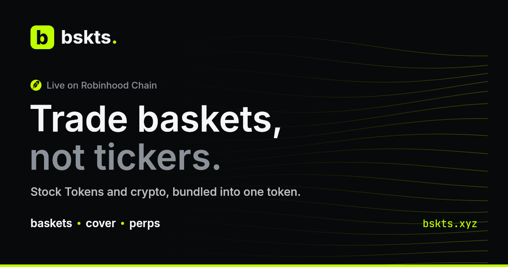

## Building bskts: trade baskets, not tickers

**[bskts.xyz](https://bskts.xyz)** turns Stock Tokens and crypto into one token: tokenized index
baskets (S&P 500, mega-cap tech, AI chips, SpaceX and crypto), live on Robinhood Chain.

- **Baskets:** index funds you can hold in a wallet, priced on-chain at what the vault holds, and
  redeemable in kind at any time
- **Swap:** fund in USDG and trade at NAV, with market, limit, TWAP and recurring orders
- **Cover:** fixed-payout cover against a basket gapping over the weekend, from Friday's close to
  Monday's open
- **Perps:** go long or short a basket

## On the side: overhead24

[overhead24.com](https://overhead24.com) is a free space-awareness site: every satellite in orbit
on a live globe, tonight's visible passes, and an open-source-intelligence view of military
satellites. It covers close approaches, orbit changes, clusters over conflict zones,
geostationary moves and a daily brief, all computed from public orbit data. Its orbit engine is
open source: [overhead24-orbit](https://github.com/dav3trad3r/overhead24-orbit) (AGPL-3.0), with
the [methodology](https://github.com/dav3trad3r/overhead24-orbit/blob/main/METHODOLOGY.md) behind
every detection.
